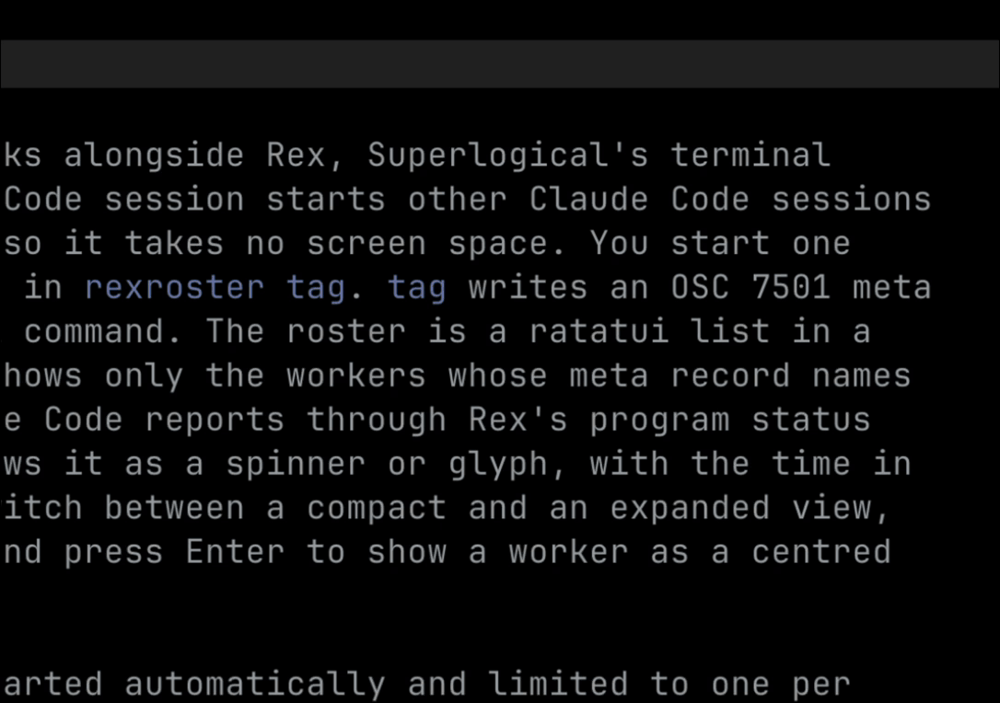

# rexroster

rexroster is a small terminal UI and command-line tool for [Rex](https://www.superlogical.com/rex), a terminal multiplexer made by Superlogical. It is for people who run one "lead" Claude Code session that starts other Claude Code sessions as workers. Each worker runs in a detached Rex block, so it takes no space on screen; rexroster lists the lead's workers in a small floating pane, shows what each one is doing, and brings a worker into view when it is waiting on a prompt.

Claude Code tells Rex what it is doing (working, waiting on a prompt, done) through Rex's [program status protocol](https://www.superlogical.com/rex/docs/build/program-status), and the roster shows that state for each worker. Any other program that sends those records works the same way.

rexroster is intended to be used mainly by your lead agents, not directly by you. Point a lead at `rexroster skill`, which prints a guide to starting and managing workers, and it runs the commands below itself. What you work with is the roster pane.



To run this demo yourself, run `docs/demo/demo.sh` from a Rex pane. Its workers are pretend ones that send the same status records Claude Code does.

## Requirements

- Rex, with its `rex` CLI. rexroster finds it at `$REX_BIN_DIR/rex` (Rex sets this in every terminal) or on `PATH`. Rex is in beta; see its [installation page](https://www.superlogical.com/rex/docs/installation).
- macOS or Linux.
- Rust 1.89 or later, to build it.

## Install

```sh
cargo install --locked --git https://github.com/ryanlewis/rexroster
```

or, from a clone, `cargo install --locked --path .`.

## Typical use

The lead agent runs this from its own pane:

```sh
rexroster spawn "$REX_BLOCK" fix-login --task "fix the login redirect" --cwd ~/dev/app -- "$(command -v claude)" "…"
```

This starts the worker as a detached block and opens the roster if it isn't open already. The roster closes itself when the last worker's block closes. It also starts the [watcher](#the-watcher), which brings a worker into view when it is waiting on a prompt.

## Commands

Every command except `watch` and `skill` reads the session from `$REX_SESSION` and stops with an error if it is not set.

| Command | What it does |
| --- | --- |
| `rexroster [--lead <block-id>] [--border none\|rounded] [--view compact\|expanded]` | Runs the roster for a lead. `--lead` defaults to `$REXROSTER_LEAD`. `--border` and `--view` override the config file for this run. |
| `rexroster open <lead-block-id> [--border …] [--view …]` | Opens the lead's roster in a floating layer at the top right of the lead's tab, without focus, unless a block labelled `roster-<last 6 characters of the lead id>` already exists. Prints the new layer id, or nothing. Exits 0 in both cases. Passes `--border` and `--view` on to the roster. Then starts the watcher, if the config's `watch` is on and no watcher is running. |
| `rexroster spawn <lead-block-id> <name> [--task <text>] [--cwd <dir>] -- <cmd> [args...]` | Starts a detached block labelled `<name>` that runs `rexroster tag <lead> [--task <text>] -- <cmd...>`, then does what `open` does. Prints `{"block_id":"…","roster_layer_id":"…"}`, where `roster_layer_id` is `null` if the roster was already open. |
| `rexroster tag <lead-block-id> [--task <text>] -- <cmd> [args...]` | Marks the terminal as the lead's worker, then replaces itself with `<cmd>`. |
| `rexroster watch` | Runs the watcher in the foreground. Exits at once, with status 0, if a watcher is already running for this user and Rex server. |
| `rexroster skill` | Prints the guide for AI agents, from [`docs/agent.md`](docs/agent.md). |

Two `open` or `spawn` calls at the same time make only one roster: each holds a lock file while it checks for the roster and creates it.

### Running the worker's command

`spawn` runs `<cmd>` directly with `exec`, not through a shell. That keeps a shell prompt from dropping the worker's meta record. So:

- Give `<cmd>` as an absolute path or a name on the server's `PATH`, for example `"$(command -v claude)"`.
- The worker also gets the `PATH` of the shell that ran `spawn`, added in front of the server's own.
- Shell syntax such as pipes, `&&` and `~` is not expanded. Wrap it in `sh -c '…'` if you need it.

### The meta record

`tag` writes this sequence to `/dev/tty` (to stdout if there is no terminal), then runs the command whether or not the write worked:

```text
ESC ] 7501 ; state=idle:id=meta:app=rexlead:msg=<base64 of {"lead":…,"task":…,"cwd":…}> ESC \
```

The roster lists a block only when this record names its own lead.

### Using it from an agent

`rexroster skill` prints a guide for an AI agent acting as the lead: how to start workers, read their state, show, hide and close them, and the traps to avoid. The guide is built into the binary, so it always matches the installed version. Point the agent at `rexroster skill` rather than copying the guide into its instructions.

## The roster

By default the roster has no frame or title, because Rex's pane title already names it. In the compact view (the default) each worker takes one line:

- `›` on the selected worker, while the roster has focus
- a glyph for the state of the worker's root status record (the one Claude Code reports): a turning braille spinner (`⠋⠙⠹⠸⠼⠴⠦⠧⠇⠏`) while working, `◐` blocked, `✓` done, `✗` error, `○` idle, `·` starting
- `▸` if the worker is shown
- the label, in a column as wide as the longest label (6 to 20 characters)
- the time in the current state
- the record's message, or the task when there is no message, cut with `…` to fit. When the record carries the worker's `cwd`, that path in the message shows as `.`, and a leading `cd <cwd> && ` or `cd <cwd>; ` is dropped.

Press `v` for the expanded view. Each worker then has a line with its label and time, then its message wrapped to the pane width (at most 3 lines), then its task in dim text if that differs from the message.

| Key | Action |
| --- | --- |
| `j` / `k`, `↓` / `↑` | Move the selection |
| `Enter`, double-click | Show the worker as a centred float beside the lead and focus it. On a shown worker, hide it again |
| `v` | Switch between the compact and expanded views (not saved) |
| `o` | Open the options panel |
| `l` | Focus the lead |
| `q`, `Ctrl-C` | Quit |

A line of key hints shows at the bottom while the roster has focus. With a border, the hints sit on the bottom border instead.

To hide a shown worker, press `Enter` on it or minimize its pane: the roster turns a minimized worker back into a hidden one. Closing a worker's pane ends the worker.

The layer's height follows the lines the workers take, plus the hints line while focused. If the roster never gets a worker, it exits after 30 seconds.

The spinner redraws every 100 ms while any worker is working. Otherwise the roster wakes once a second to update the times.

rexroster has no key binding of its own. To move focus between a lead and its roster from the keyboard, add a [custom action](https://www.superlogical.com/rex/docs/customize/actions) to Rex's `init.lua` that finds the block labelled `roster-<last 6 characters of the lead id>` in the active window and focuses it with `rex.session.focus_block`, bind it with `rex.bind`, then run `rex config reload`.

## The watcher

`rexroster watch` floats a detached worker into view when it is waiting on you, and puts it back when it moves on:

- When a detached block's own status record turns `blocked` (for example a Claude Code permission prompt), the watcher moves it into its session's active window as a large floating pane.
- When the record turns to any other state, or goes away, the watcher detaches the block again. If the block closed, there is nothing to do.
- Blocks that are already in a window are left alone.

It watches every session on the Rex server, including ones created later. The work is done by a Lua script built into the binary ([`lua/blocked-float.lua`](lua/blocked-float.lua)). The watcher replaces itself with `rex do -e <script> --all`, so in a process list it shows as `rex do`.

`open` and `spawn` start the watcher in the background, in its own session with no terminal, so closing the shell or the roster does not stop it. Set `watch = false` in the config to turn this off.

Only one watcher runs per user per Rex server. It holds a lock file in `$XDG_RUNTIME_DIR/rexroster/`, or in `rexroster-<uid>/` under the temp directory when `XDG_RUNTIME_DIR` is not set, for as long as it runs. A second watcher finds the lock taken and exits. The lock goes when the process ends, however it ends. rexroster refuses a lock directory that another user owns or can open.

If the config file can't be parsed, `open` and `spawn` print a warning and don't start the watcher, and `rexroster watch` stops with the error.

The watcher runs until the Rex server goes away or the process is killed. It reads `notify` when it starts, so restart it after changing that option: kill the `rex do` process, and the next `open` or `spawn` starts a new one.

### Notifications

Notifications are optional and off by default. With `notify = "none"` (the default) the watcher only floats and sinks.

With `notify = "cases"`, the watcher also runs a separate `cases` CLI: it opens a "stuck" case with the prompt's message when it floats a worker (`cases open --kind stuck …`), and withdraws the case when the worker sinks (`cases withdraw`). rexroster does not provide `cases`; leave this off unless you have a tool by that name that takes those commands.

## Options

Options live in `$XDG_CONFIG_HOME/rexroster/config.toml`, or `~/.config/rexroster/config.toml` when `XDG_CONFIG_HOME` is not set:

```toml
border = "rounded"   # "none" (default) or "rounded": a box titled "workers"
view = "expanded"    # "compact" (default) or "expanded": the view the roster starts in
watch = false        # true (default) or false: whether open and spawn start the watcher
notify = "cases"     # "none" (default) or "cases": see Notifications above
```

A missing file or key means the default, and unknown keys are ignored. If the file can't be parsed, the roster shows one error line and uses the defaults. `--border` and `--view` on the command line win over the file.

Press `o` to open the options panel in the roster:

- `j`/`k` or the arrow keys move between options.
- `Enter`, `Space`, `←` or `→` change the value, as does clicking an option. Changes apply straight away.
- `Esc` or `o` closes the panel and saves the options you changed to the config file. Other keys and comments in the file are kept.

The roster writes this file itself, so don't manage it with a dotfiles tool that would overwrite it.

## Development

```sh
cargo fmt --check
cargo clippy --all-targets --locked -- -D warnings
cargo test --locked
cargo deny check
```

The tests replay `rex events --json` output recorded in `testdata/` and never call `rex`.

Licensed under either of MIT or Apache-2.0, at your option.
